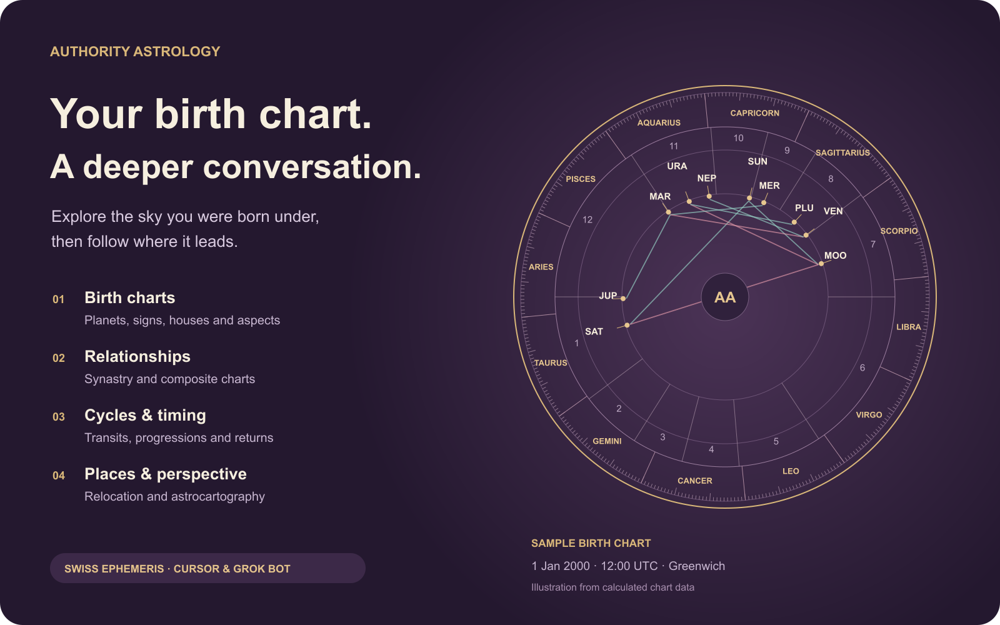

# Authority Astrology: Birth Chart Calculator

For Cursor and Grok Bot.


Your birth chart, relationships and planetary cycles, explored with your assistant with Swiss Ephemeris calculations.



## What you can do

| Explore | What you can do |
| --- | --- |
| Birth charts | Calculate planets, signs, houses, angles and aspects from your birth details. |
| Relationships | Compare two charts with synastry, or calculate a composite chart. |
| Timing and cycles | Explore transits, secondary progressions, and solar, lunar or Saturn returns. |
| Places | Calculate relocated charts and astrocartography. |
| More chart techniques | Calculate horary and electional charts; look up eclipses, sky events and celestial positions. |
| Your saved details | Connect your account to choose saved people, retrieve raw charts and save a new calculation when you ask. |

## Try asking

- “Calculate my birth chart and explain my Sun, Moon, rising sign and major aspects. Ask me for the details you need.”
- “Compare our birth charts with synastry and explain the cross-chart aspects.”
- “What transits affect my natal chart this month?”
- “Use my saved birth profile to calculate my next solar return.”

This package can prompt for an account connection when enabled. Public service endpoints also support anonymous discovery; connected workflows use your existing permissions.

Swiss Ephemeris supplies chart calculations; your assistant supplies any interpretation. Exact, approximate and unknown birth times stay distinct. Astrology is for reflection and entertainment. The visual illustrates a synthetic sample chart for 1 January 2000 at 12:00 UTC in Greenwich.

## Install and connect

This repository is a standalone Cursor plugin package. Marketplace availability
depends on review; publication of the repository is not approval.

For local testing in Cursor, copy this repository's contents (including
`.cursor-plugin`) into `~/.cursor/plugins/local/authority-astrology`, then
restart Cursor. Open **Customize** and verify that the skills and MCP server
appear. Local imports must be allowed by your organization. See
[Cursor's plugin documentation](https://cursor.com/docs/plugins).

This package configures OAuth explicitly. Cursor may request an account
connection when the plugin is enabled, including before public
searches/calculations. Sign in on Authority Astrology, review the permissions
and approve only the intended account. Account connection is required for the
package's private workflows.

Grok Bot uses the same plugin ecosystem. Once available, install through its
plugin interface; see
[Grok Bot setup](https://cursor.com/docs/grok-bot/get-started) for
account/client requirements.

The package's MCP configuration is:

```json
{
  "mcpServers": {
    "authority-astrology": {
      "url": "https://authorityastrology.com/mcp/claude",
      "auth": {
        "CLIENT_ID": "44227848-8674-476a-964a-67acc4487985",
        "scopes": [
          "account:read",
          "profiles:read",
          "charts:read",
          "charts:write"
        ]
      }
    }
  }
}
```

The client ID identifies this public OAuth application; it is not a password or
secret. No client secret, token, authorization header or user credential is
bundled. The registered callbacks are Cursor's HTTPS callback and local callback
paths; S256 PKCE is mandatory. The host stores each user's tokens after consent
and refreshes them normally. Disconnect through the host's connector controls;
reconnect when consent expires or is revoked.

The `/claude` suffix is the existing OAuth-compatible endpoint, not a client
restriction. The original OpenAI/Muse and Claude packages are unchanged.
Explicit [static OAuth configuration](https://cursor.com/docs/mcp) avoids a
Cursor 3.24.18 behavior in which reconnecting an anonymous server can report
success without obtaining an account token.

### Anonymous access

The service still supports public tools without sign-in. To use only public
features in a custom MCP client, configure
`https://authorityastrology.com/mcp/claude` as a URL-only server without this
package's `auth` object. Do not enable that manual server alongside the full
plugin. In Cursor 3.24.18, that anonymous configuration works for public calls
but does not reliably upgrade to account access; use this full package for
private workflows.

## Reviewer test plan

See [TESTING.md](TESTING.md) for public smoke tests, optional account workflows,
expected results and safety boundaries. Test both local component discovery and
real tool calls in each target host before attesting that the plugin works
in-app. Protocol tests alone do not establish host compatibility.

## Data and privacy

The skills invoke only the declared Authority Astrology MCP server. The package
runs no local scripts, hooks, installers or background processes. The hosted
service receives tool arguments and, after OAuth consent, the account
permissions needed for the requested action. It does not require the full
conversation. Birthplace searches use LocationIQ. Birth details and calculated
charts are personal data; saved charts follow the service retention and deletion
policy. See the
[privacy policy](https://authorityastrology.com/privacy-policy#connected-assistants),
[terms](https://authorityastrology.com/terms) and
[developer documentation](https://authorityastrology.com/developers) for
details.

## Pricing and scope

This MIT-licensed plugin is distributed free of charge. Public
searches/calculations require no account. Private workflows require an
appropriate account and remain subject to its permissions and service limits.
The plugin cannot purchase subscriptions, reports, contact unlocks or credits.
The host application may require its own subscription. Website services and
their terms are separate from this package.

## Support

Use [Authority Astrology support](https://authorityastrology.com/support). If a
tool reports a rate limit, wait for its retry interval; do not invent missing
results. Report reproducible plugin issues in this repository without including
credentials, private records or real birth details.

## License

The plugin files are MIT licensed. No hosted application code, database
contents, Swiss Ephemeris binaries or calculation datasets are distributed here.
Hosted services and their data remain subject to their own terms.
